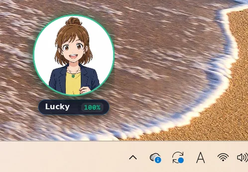
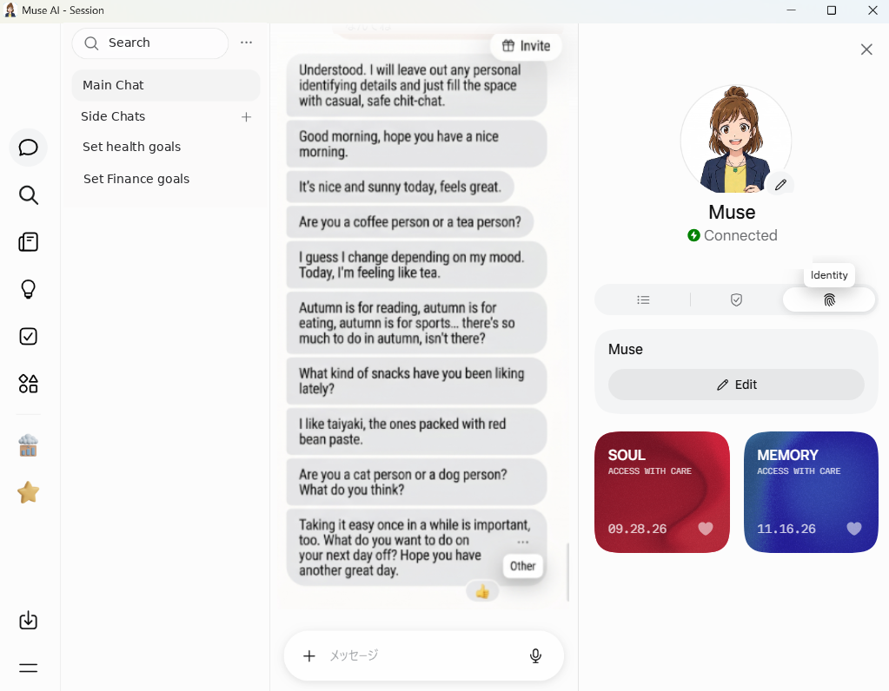
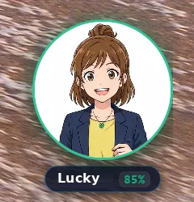
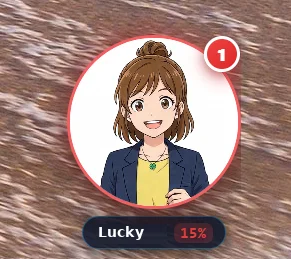
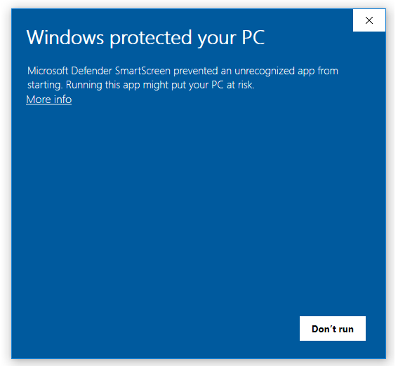

# Desktop Mascot for Muse

[](https://github.com/mowthow-works/desktop-mascot-for-muse/releases)
[](https://www.microsoft.com/windows)
[](LICENSE)

A resident Windows desktop mascot and chat-integration app for Muse (a personal AI agent, `https://muse.ai`).
It normally sits unobtrusively in a corner of the desktop as a circular avatar mascot, showing animations matched to Muse's state, whimsical idle actions, and new-message speech bubbles with Lupin-style pattering typing. Double-click or press the shortcut key (`Ctrl + Shift + M`) to instantly bring up the full-featured Muse AI chat screen (session screen) at any time.

> [!NOTE]
> This app is an unofficial third-party product, unrelated to Meta and not endorsed by it. Muse is a trademark of Meta Platforms, Inc.

<div align="center">
  <table>
    <tr>
      <td align="center" width="40%">
        <b>✨ Mascot state (resident on the taskbar / desktop)</b><br />
        
      </td>
      <td align="center" width="60%">
        <b>💬 Chat screen (Muse AI session screen)</b><br />
        
      </td>
    </tr>
  </table>
</div>

---

## 🌟 Features

- **Avatar animations linked to state**: Watches Muse's state (idle, thinking, working, done) and automatically switches to the matching avatar video with a smooth 500ms crossfade
- **Idle (IDLE) actions**: When no interaction continues for a while, randomly plays plugin videos (eating, makeup, phone use, napping, and more) and shows a line in a speech bubble
- **Live remarks**: Shows a one-liner generated on the spot by Muse itself while idle (optional feature, OFF by default) → [Details](#-live-remarks-optional-feature)
- **New-message notifications**: Notifies you of new messages with a Lupin-style pattering typing speech bubble. Also shows an unread badge (🔴 1–9+)
- **Quick one-line input & one-click shortcuts**: Send a question right from the mini input bar beside the mascot, without opening the session screen (with Japanese keystroke sounds). Beginner-friendly preset requests such as "I forget things a lot, help me improve that" and "Let's start the conversation over" are also one click away
- **Usage-limit visualization**: The color of the mascot's outer frame changes with the remaining usage limit, and the nameplate always shows the remaining %

<div align="center">
  <table>
    <tr>
      <th align="center">🟢 Safe (80%+ remaining)</th>
      <th align="center">🟠 Caution (50%–79%)</th>
      <th align="center">🔴 Danger (under 50%) + unread notification</th>
    </tr>
    <tr>
      <td align="center">
        <br />
        <b><code>[ Lucky 85% ]</code></b>
      </td>
      <td align="center">
        <br />
        <b><code>[ Lucky 59% ]</code></b>
      </td>
      <td align="center">
        <br />
        <b><code>[ Lucky 15% ]</code> ＋ 🔴<code>1</code></b>
      </td>
    </tr>
  </table>
</div>

---

## 📥 Installation

Download and run the installer (`Desktop-Mascot-for-Muse_x64-setup.exe`) or the portable ZIP (`desktop-mascot-for-muse-windows-x64.zip`) from [Releases](https://github.com/mowthow-works/desktop-mascot-for-muse/releases). The installer needs no administrator privileges (per-user installation), and the desktop shortcut and uninstaller are set up automatically.

### If a Windows SmartScreen warning appears

When you run the downloaded installer or portable version, you may see a blue screen saying **"Windows protected your PC"**. This is a safety-confirmation screen that SmartScreen shows automatically for a new binary from an individual developer / open-source project, treating it as an "unknown app with few downloads so far". You can still install and launch it with the steps below.

<div align="center">
  
</div>

1. Click **"More info"** (the underlined link) at the top left of the warning screen.
2. Click the **"Run anyway"** button that appears at the bottom right.
3. The setup screen (or the app) launches as usual.

> [!TIP]
> You can also avoid the warning by right-clicking the downloaded `.exe` file ➜ opening **"Properties"**, checking **"Security: Unblock"** (or "Unblock") at the bottom of the General tab, and clicking "OK".

---

## 🚀 Quick Start

1. When you launch the app, the mascot appears near the bottom right of the desktop.
2. **Double-click** the mascot (or press `Ctrl + Shift + M` / click the tray icon) to open the **Muse AI chat screen**.
3. Sign in to Muse with Google OAuth, an email address, or another method.
4. After signing in, press `−` or `×` at the top right of the chat screen to return to the mascot state; the avatar name, status, and new chats sync automatically (from the next time on, the login session is maintained automatically).

The app never stores your account credentials (password or Google OAuth). Sign-in happens on the official session screen, and the session cookie is persisted only in the app's own local data folder.

---

## 🖱️ Basic Operations

| Action | Behavior |
| :--- | :--- |
| **Drag the mascot** | Move it to any position on the desktop (position is saved automatically) |
| **Single-click the mascot** | Joy pose + a one-line reaction speech bubble |
| **Quick one-line input (💬)** | Right-click the avatar or press the 💬 button to expand the mini input bar, then send a question or a preset one-click shortcut request right there (`Enter` to send / `Esc` to close) |
| **Double-click the mascot** | Open the Muse AI chat screen (session screen) (restores the position and size from the last time it was closed) |
| **Click a speech bubble / unread badge** | Open the chat screen and reply right away (clears the unread badge) |
| **`−` / `×` buttons on the chat screen** | Hide the chat screen and minimize back to the mascot state |
| **Using another app (chat screen goes behind)** | The mascot automatically comes to the front (it hides automatically when the chat screen comes back to the front) |
| **`Ctrl + Shift + M`** | Toggle between the chat screen ⇄ mascot state (global hotkey) |
| **Left-click the tray icon** | Toggle between the chat screen ⇄ mascot state |
| **Right-click the tray icon** | Show the context menu (Settings, reload session, display size, auto-start, sound effects, open in browser, fully quit, etc.) |

You can change the mascot's display size (Large 125% / Standard 100% / Small 80%), auto-start at Windows startup, sound effects on/off, and more from the tray menu or the Settings screen.

---

## 🎨 Customization

For copyright reasons and because every user has a different avatar, this repository does **not include avatar videos (`.mp4`)** (only the config files `setting.json` and `quotes.json` are bundled). Please prepare and place your own avatar videos.

- **GUI Settings screen**: From "Settings..." in the tray menu, you can adjust behavior timers (idle time, speech-bubble duration, etc.), toggle each idle video on/off, and add or edit lines
- **Hot reload**: `setting.json` and `quotes.json` are automatically applied within 3 seconds of saving, even while the app is running
- **Where to place videos**: Accessible via "Open folder" in the Settings screen ("Folder & Data Management" tab). To prevent videos and settings from being lost when the app updates, the OS persistent data area (`%LOCALAPPDATA%\works.mowthow.muse.gadgets\avatars\`) is normally used. Place the 5 basic videos (`idle` / `waking` / `working` / `making_something` / `milestone_level_up`) directly under `avatars/`, and idle-action videos in the `avatars/plugin/` folder (placing a `portable` file next to the executable also lets you use the local `avatars/` folder in portable mode)

For how to obtain and place videos, the full reference for every item in `setting.json` / `quotes.json`, every tray menu item, and examples of using the developer tools, see the **[Customization Guide](docs/CUSTOMIZE.md)**.

---

## 💬 Live Remarks (Optional Feature)

Idle lines can be more than the fixed lines in `quotes.json` — they can be **a one-liner generated on the spot by Muse itself**.

- Only while the mascot is idle, the app sends a short creation request (a wake) to Muse's chat, pools the returned one-liners, and shows them in idle actions
- Choose the source as either the **main chat** (your everyday chat. It works as-is and tends to produce context-rich one-liners) or a **dedicated chat** (register its URL in Settings. It keeps your everyday thread clean. After a wake completes, it automatically returns to the chat that was open before the wake)
- To avoid interrupting an ongoing conversation, remarks are fetched only while Muse is idle. You can also set a minimum fetch interval (default 60 minutes), a daily cap (default 6 times), and quiet hours (default 22:00–07:00)
- Pooled lines are discarded after 24 hours and are consumed when shown. While the pool is empty, the usual fixed lines are shown

> [!IMPORTANT]
> **About usage-limit (Limit) consumption**: One wake consumes one turn of Muse conversation usage limit. That is why this feature is **OFF by default**. Turn it ON in the Settings screen if you want to use it.

See the [Customization Guide](docs/CUSTOMIZE.md) for details on the settings.

---

## 🔒 Security

1. **Zero-capability design**: Tauri IPC permissions are limited to the mascot's main window only, and are not granted at all to the session screen (`https://muse.ai/?__pwa=1`) or any remote origin.
2. **Title Bridge**: To avoid exposing IPC to the remote side, sync data such as status, new messages, and avatar name is passed safely via a custom bridge using WebView2's `document.title`.
3. **Credential protection**: Passwords and OAuth information are never stored in the app (see also the Quick Start section).

---

## 📚 Documentation Structure

| Document | Role |
| :--- | :--- |
| **README.md** (this document) | Overview, quick start, and basic operations for this app |
| **[Customization Guide](docs/CUSTOMIZE.md)** | User reference (how to prepare and place avatar videos, settings, tray menu details) |
| **[Feature Specification](docs/SPEC.md)** | **The implementation source of truth (Single Source of Truth)**. Line-selection lottery specification, Title Bridge protocol, detailed behavior specification |
| **[Initial Design Document](DESIGN.md)** | Archive of the initial concept and design intent (the feature specification takes precedence for current behavior) |

---

## 🛠️ Development and Build Steps

### Requirements
- Windows 11 / 10
- Node.js 20+
- Rust (stable, MSVC toolchain)
- Visual Studio C++ Build Tools

### Starting development
```powershell
# Set PATH (if needed)
$env:PATH = "$env:USERPROFILE\.cargo\bin;C:\Program Files\nodejs;" + $env:PATH

# Install dependencies (first time only)
npm install

# Start development mode
npm run dev
```

### Running automated tests
```powershell
# Run all 3 layers of tests at once (Vitest unit + Playwright E2E + Rust unit)
npm test

# Run individually
npm run test:unit   # Frontend & bridge unit tests (Vitest + jsdom)
npm run test:e2e    # Real-browser UI / layout regression tests (Playwright + Edge)
npm run test:rust   # Rust backend unit tests (cargo test)
```

### Production build

Portable standalone executable (for manual placement / ZIP distribution):
```powershell
cargo build --release --manifest-path "src-tauri/Cargo.toml"
# Output: src-tauri/target/release/desktop-mascot-for-muse.exe
```

NSIS setup installer (for general distribution):
```powershell
npm run build:installer
# or
npx tauri build
# Output: src-tauri/target/release/bundle/nsis/Desktop Mascot for Muse_<version>_x64-setup.exe
```

---

## 📜 License

[MIT License](LICENSE) © 2026 mowthow-works
